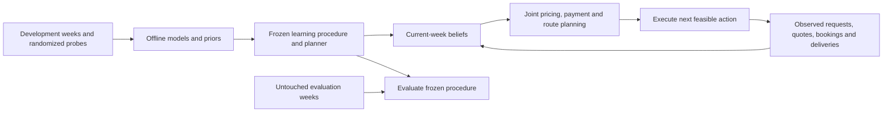

# First-round findings and the next research program

Continuation: [second-round results and decisions](second-round-findings.md), [reproducible methods](value-research.md), and [next portfolio-planner design](portfolio-research-design.md). The second round did not replace either preserved selection.

Recorded 14 November 2026, after the first five-run ranking round at levels 1–7. This is an evidence review and proposed research program. Proposed models and planners below are not implemented or validated merely because they appear here.

The main failure was transferring a dispatcher designed around level-8 scarcity and competitive pricing into different market rules without sufficiently checking its economic and operational assumptions. Seven qualifying compatibility runs established that it could complete those worlds. They did not establish competitive performance. Starting ranking from that evidence was my mistake. The later deadline deployment improved the outcome, but it was an explicitly authorized deployment exception, not a successful independent validation.

The strongest new finding is structural: at levels 1–3, correcting acceptance economics while keeping normal driver pay produced large gains. Cutting pay and broadening admission indiscriminately was much less reliable. This supports a new research direction: learn the consequences of accepting work and optimize acquisition and fulfillment together, rather than treating the incumbent's thresholds as fixed.

**What the ranking round actually established**

All 35 authorized ranked worlds completed by 08:49:14 Helsinki, before the 09:00 cutoff. All qualified, with no undelivered orders or failed visits. Total margin was €166,020.12 over 12,471 orders. These are retained outcomes, not a general reliability guarantee. The positions below are the official snapshot at 08:50:30 Helsinki, not a claim about a later closed leaderboard.

| Level | Total margin, five runs | Mean weekly margin | Aggregate on time | Position at snapshot |
|---|---:|---:|---:|---:|
| 1 | €27,111.04 | €5,422.21 | 98.95% | 9 |
| 2 | €30,337.65 | €6,067.53 | 99.16% | 10 |
| 3 | €26,373.18 | €5,274.64 | 99.11% | 9 |
| 4 | €19,343.93 | €3,868.79 | 96.91% | 10 |
| 5 | €17,799.86 | €3,559.97 | 95.11% | 10 |
| 6 | €17,168.14 | €3,433.63 | 95.39% | 20 |
| 7 | €27,886.32 | €5,577.26 | 98.45% | 18 |

The initial run at each of levels 1–4 used the old control. The remaining 31 used a frozen level-aware deadline policy: corrected admission at levels 1–3, the economics variant with original capacity at levels 4–6, and the control at level 7. Consequently, the round is not a clean comparison between two policies. There were 29 action errors, three recoveries associated with the initial pause, and one €100 fine. All remain in the audit; qualification does not erase them. See the [ranked audit](levels-ranked-audit.json), [server snapshot](levels-final-server.json), and [deadline protocol](../experiments/levels-deadline-protocol.json).

The practice ranking rewards all-five-run qualification before total margin within each group. Both the probability of completing the entire round successfully and profit conditional on success matter. The final has a separate top-ten selection rule; practice rank and final qualification are different objectives. See the [official handbook](https://spread.bahnexpress.com/kit/HANDBOOK.md).

**Findings, with the limits of each experiment**

1. **Known rules must constrain the optimizer.** Below level 4, every quote wins the original first option at its list price. The old feasibility loop could approve a later option while the server awarded the earlier one. In the failed abundance probes, 149 level-1 wins and 153 level-2 wins omitted the first option; 34 and 24 of those orders were late. That association identifies exposure to a real semantic error, not the causal size of fixing it. The first-option-only treatment, by itself, barely changed profit under conservative admission. See the [diagnosis](levels-first-option-diagnosis.json) and [rules](https://spread.bahnexpress.com/kit/RULES.md).

2. **Acceptance was an enormous bottleneck in the abundant regimes.** The old low-level gate required list price to exceed `1.3 × base fee`. The new gate uses opening payment divided by the retained-margin fraction, while preserving the original payment and capacity settings. It also checks the actual first option. Opening payment is still only a cost proxy; eventual rescue, refunds, and displaced work can cost more.

| Level | Control mean | First-option fix alone | Fix plus opening-cost admission | Mean paired gain | Worst candidate week on time |
|---|---:|---:|---:|---:|---:|
| 1 | €911.33 | €905.00 | €6,744.75 | +€5,833.42 | 98.28% |
| 2 | €902.25 | €902.92 | €7,007.69 | +€6,105.44 | 99.05% |
| 3 | €870.41 | €854.40 | €6,257.79 | +€5,387.38 | 99.03% |

Mean throughput increased from about 78 to 525–530 orders per week. Candidate driver fees averaged €28,096–€28,604 per week; the larger revenue covered that increase in these trials. All nine candidate worlds qualified with no undelivered orders or failed visits; two action errors occurred. This was **27 worlds on three unique development seed blocks**, reused across policies and levels, not 27 independent weeks. Level 3 also shares the underlying world with level 2. The candidate passes its development screen, but has no fresh independent validation. All three replicated level-1 controls have byte-identical event histories to the earlier controls. See [complete results](levels-first-option-complete-analysis.json) and [control conformance](levels-first-option-control-conformance.json).

3. **Cheap payment and high volume are not generally complementary.** The initial abundance probes failed qualification at levels 1 and 2. In the subsequent frozen 36-world factorial, the economics arm gained €2,852/week at level 1 and €1,268 at level 4, but lost €4,072 at level 7 and failed two of its three level-7 weeks. Coupling economics with broader admission lost €7,844/week at level 7 and failed all three weeks. No arm passed every predeclared development criterion at its tested level. The economics arm changed payment, quote economics, and the trust coefficient together, so it does not isolate a pure payment effect. Three seed blocks are the independent sampling unit, not 36 worlds. See [abundance results](levels-abundance.json) and [factorial analysis](levels-factorial-analysis.json).

4. **Better prediction on incumbent data did not imply better decisions.** The 16-feature fulfillment-cost model improved RMSE only 0.365% over a fitted scalar on four new development weeks and failed its predictive gate. Deploying the cheaper scalar cost estimate increased throughput 17.6%, but lost €1,022/week: additional revenue was outweighed by fees and refunds. A higher cost estimate also lost €664/week. Changed prices and acceptance change the workload on which costs are incurred. Existing accepted-order data do not identify those counterfactual costs. Job mix, congestion, and driver responses remain competing explanations; the experiment did not isolate them. See [prediction assessment](fulfillment-cost-assessment.json), [lower-cost policy](cost-calibration-results.json), and [higher-cost policy](cost-premium-results.json).

5. **Several architectural implementations failed; their broader ideas remain open.** On four matched old development weeks, joint acquisition lost €504/week, calendar admission lost €8,595/week, and high volume with premium driver pay lost €7,003/week. The latter two failed qualification in some weeks. Larger routes lost €987/week alone and €23/week with broader volume. The short first-view payment premium lost €214/week on two weeks. These are reasons to reject those frozen implementations. They do not prove that joint planning, dynamic capacity, or driver incentives cannot win. Narrow screens assuming the incumbent's accepted work cannot bound the value of an architecture that changes that work. See [architectures](architectures-results.json), [larger routes](multi-routes-results.json), and [payment pulse](viewed-fee-results.json).

6. **Some earlier level-8 learning was real but narrow.** The payment refinement gained €636/week on a historical 12-pair fresh panel, winning ten pairs, but on-time delivery fell from 97.98% to 96.21%. All twelve qualified, with a minimum of 93.8%. Under IID-week sampling, twelve successes give only about a 77.9% one-sided 95% lower bound on qualification probability. That panel also was not corrected retroactively for the entire adaptive research history. It supports retaining a useful control, not claiming universal robustness or transferring it automatically to other levels. See [payout validation](payout-validation.json).

**The scientific error to avoid next**

The evidence establishes a rules mismatch and regime-specific policy failure. It does not prove literal memorization of one seed. Repeated architecture and parameter selection on a small collection of weeks nevertheless creates a serious selection-overfitting risk. Optimizing a noisy model-selection score can itself overfit; the entire selection procedure must sit inside the development boundary. See [Cawley and Talbot, 2010](https://www.jmlr.org/papers/v11/cawley10a.html).

Compatibility, promising development, independent validation, and ranking are four different stages. They need separate decisions. The deadline exception must remain labeled as an exception even though all ranked runs eventually qualified. Later completed development results cannot retroactively validate an earlier deployment decision.

**How offline and online learning work today**

Current offline work consists mainly of manual hypothesis generation, frozen configuration comparisons, and a rejected cost-model experiment. The default does not load a broadly trained global fulfillment model. Online, the demand model updates a logistic win-probability estimate and its covariance from actual quote wins and losses. It includes week, day, origin, destination, dealer, and distance effects, then chooses a customer price using that estimated response. Deliberately losing rejection quotes are excluded from learning. Each new week starts from its configured prior.

Driver payments, most capacity restrictions, and route construction remain largely hand-written rules. There is no learned booking-time model, no calibrated model of supply opportunity cost, and no joint optimization over acceptance, payment, customer choice, and future capacity. The existing offline–online loop is therefore partial. See [pricing implementation](../src/optimizer.ts), [dispatcher](../src/policy.ts), and the [existing mathematical description](optimization-model.md).

**The proposed architecture**

Use a model-based rolling-horizon dispatcher with a belief about the current market and supply. Offline learning supplies transferable priors; online observations update current-week beliefs; a constrained planner turns both into actions.

The validation branch cannot feed model changes while still being called untouched. If its outcomes influence a change, retire the entire panel and evaluate the changed procedure on new weeks.

Offline models should predict customer choice, booking time and no-booking probability, drops, travel and service-time tails, refunds, and the future value of available capacity. Begin with interpretable hierarchical models and calibrated uncertainty. Learn from structural features such as travel time, deadline slack, destination supply, outstanding commitments, equipment, and time of day. Persistent location or dealer effects may be useful, but should shrink toward pooled estimates and have an unseen-ID fallback. Seed IDs and future events must never be features.

Online learning should infer which market and supply conditions apply now. A driver not booking is a censored observation, not proof that a particular fee is below their cost. Current-week adaptation may update competition, booking hazards, and supply beliefs, within frozen bounds. Freeze the update rule, initial prior, features, optimizer, exploration budget, and fallback behavior—not the posterior values it is supposed to learn. Reset to the same frozen prior at the start of every evaluation week. If cross-week adaptation is desired later, evaluate independent sequences of weeks rather than pretending their constituent weeks are independent.

At each decision, generate feasible routes and payment plans, consider alternative customer prices or delivery menus, and estimate their incremental value:

`expected revenue − expected fees/refunds/fines − value of capacity consumed + value of future state`.

Use sampled plausible futures to include partial quote wins, booking uncertainty, driver repositioning, cancellations, and deadline risk. Execute the next action, observe what actually happened, and replan. Drivers choose whether to book: a route optimizer cannot assume it can assign any visible driver. For route search, compare insertion/local search and adaptive large-neighborhood search, with bounded mixed-integer or set-packing optimization for small batches. Exactness applies only to that formulated subproblem. Joint routing and pricing through opportunity costs is a supported research direction, but published delivery results are not evidence that this implementation will win Spread. See [Prokhorchuk, Dauwels and Jaillet](https://arxiv.org/abs/1912.02946).

A credible objective is expected weekly net margin subject to a predeclared qualification target, with explicit reporting of downside profit and lateness. For the practice leaderboard, also assess the probability all five runs qualify. If weekly qualification were independent with probability 0.95, all-five success would be only 0.774; at 0.99 it would be 0.951. Those examples illustrate the stakes, not assumptions verified for the server's five seeds. An unknown stochastic environment does not permit an honest certificate of absolute global optimality. Planner bounds can diagnose missed value inside a model, but cannot certify the full dispatcher.

**Three distinct hypotheses worth funding**

| Approach | Mechanism and potential large gain | Evidence that would reject the candidate |
|---|---|---|
| Capacity opportunity prices | Estimate the marginal value of a driver-hour by location and deadline; admit volume when capacity is cheap and raise prices or decline when it is scarce. Replace fixed count thresholds. | No material paired profit gain, poor calibration in shortage, or larger refunds/qualification failures despite predicted capacity value. |
| Route formation before acceptance | Price and accept compatible work jointly, accounting for both/all/partial wins and booking probability. A return leg or shared pickup can change the economics of acquiring either job. | Modeled route savings disappear after partial wins, waiting and driver reactions; whole-week net profit or reliability fails the gate. |
| Driver-aware fulfillment and payments | Infer availability and booking response; coordinate public payments, direct offers where available, and routes that leave drivers in useful locations. | Faster booking costs more than the avoided refunds and additional profitable work, or the response model fails on untouched weeks. |

Keep a deliberately broad-volume candidate within this program, supported by different fulfillment logic. Merely loosening the old admission threshold and hoping rescue scales has already failed. Reserve roughly half of development effort for these architectural departures, a quarter for mechanism/model work, and a quarter for reproducibility, ablations, and controls. Independent validation receives a separate protected simulation budget. These are prospective allocations, not claims about work already done.

**Data and causal learning**

Record the public predecision state, available actions, selected action, model predictions and uncertainty, and subsequent booking, cost, and delivery outcomes. For bounded randomized unranked probes, record the actual action-selection probabilities. Preserve censored observations and route-level shared costs; arbitrary division of a multi-order gig fee produces misleading order labels.

Use paired forks for local mechanism questions and complete matched weeks for policy value. A fork and its parent are one week cluster. Historical deterministic logs lack support for many unchosen prices and payments. Doubly robust evaluation can combine response models with logged behavior probabilities where overlap exists; it does not manufacture missing support or turn a contextual-bandit estimator into an evaluator of the entire sequential dispatcher. See [Dudík, Langford and Li, 2011](https://arxiv.org/abs/1103.4601).

A cheap learned simulator can screen proposals, but must be checked on held-out transitions and policy rollouts. Use uncertainty penalties and the official simulator for final policy comparisons. Replaying a fixed future event stream after changing acceptance or payment is not a valid counterfactual when those actions alter future events. In poorly supported situations, test falling back toward the control; baseline bootstrapping is a useful design precedent, not an imported safety guarantee. See [Laroche, Trichelair and Tachet Des Combes, 2019](https://proceedings.mlr.press/v97/laroche19a.html).

**Execution order and promotion rules**

1. **Finish the mechanism contract before another ranked round.** Verify actual awarded options, level capabilities, changed-route charging requirements, and stale-action handling. Add meaningful invariance tests: relabeling arbitrary IDs must not change behavior when features are preserved; later outcomes must not change earlier decisions. Preserve the level-8 control and the corrected low-level development candidate separately. Do not silently replace the validated control.

2. **Fit and challenge transferable response models.** Use week-grouped training and inner validation, never random request rows across the same week's split. Compare simple pooled models with hierarchical alternatives. Measure calibration and decision sensitivity, not only prediction error. Collect limited randomized interventions where legacy data lack coverage. Rank research tasks by expected decision value per simulation, not by the number of configurations produced.

3. **Compare a small set of different planners on matched development weeks.** Include abundant and scarce supply, uneven geography, tight deadlines, and high workload. Freeze each candidate for its comparison. Use factorial ablations to separate acceptance, payment, and route effects, including interactions. The user's 14 November operational limit is **four unfinished team worlds total**, superseding the earlier eight-slot assumption. Current research uses two workers and checks shared occupancy before each creation. Concurrent worlds do not create additional independent observations. Serialize world creation and coordinate shared occupancy. Reject weak candidates without searching endlessly for a favorable parameter rescue.

4. **Select one finalist and freeze a genuinely new validation panel.** Record source/model/settings hashes, all seed IDs, sample size, planned level coverage, profit and reliability tests, multiplicity allocation, and interruption rules before the first play. Use development paired variance and a meaningful gain to size the panel; the existing minimum of 24 unique pairs is a floor, not a power calculation or reliability guarantee. If resources cannot support the required precision, report the unresolved uncertainty rather than relaxing criteria after seeing results.

5. **Evaluate the complete adaptive procedure.** Retain every week, failure, action error, fine, and recovery. Report paired net margin, qualification confidence bounds, low-tail margin, throughput, fees, refunds, lateness, undelivered work, failed visits, and runtime. Separate results by intended level and supply regime. Stress tests are useful but must remain distinct from a representative estimate of target performance. Test unseen identifiers and feature combinations where possible, not just new pseudorandom seeds from familiar conditions.

6. **Promote only from the predeclared decision.** The current prospective integrity policy requires at least €1,500 mean paired gain, a positive adjusted lower confidence bound, all candidate weeks qualifying, no undelivered orders or failed visits, at least 92% on time in every week, and at most a 0.5 percentage-point aggregate on-time decline versus control. Whether the last condition is economically appropriate against a low-volume control should be debated before a new untouched panel, never changed to rescue its results. Allocate error probability across repeated finalist attempts and across intended level claims. Any outcome-driven revision retires the panel and requires another untouched one. Then run one frozen ranking policy without human changes in response to a weak ranked week.

Twenty-four successes in 24 IID weeks give only an 88.3% one-sided 95% lower bound on qualification probability; a multiplicity-adjusted bound is lower. Demonstrating at least 99% qualification with zero failures at ordinary one-sided 95% confidence would require 299 IID weeks. These are illustrations of the uncertainty, not demands to spend that many simulations before any useful development decision. A small passing panel must never be described as a safety guarantee.

The updated registry contains 365 named-seed world records but only 76 unique named weeks; server-selected ranked worlds are recorded separately without inventing independent seed counts. These counts document the amount of adaptive search, not 365 independent confirmations.

The [search-integrity policy](../experiments/search-integrity.json) already records prospective alpha spending, panel retirement, and full-outcome retention. It does not retroactively repair historical selection. The [seed registry](../experiments/seed-registry.json) makes every observed seed unavailable for future untouched validation. Future multi-level claims need an explicit allocation within the existing statistical budget; a pooled average cannot conceal a failing level.

The immediate engineering priority is a joint acquisition-and-fulfillment planner with learned booking response and capacity value. The immediate scientific priority is a clean development/selection/validation boundary. Neither a larger parameter sweep nor a switch to end-to-end reinforcement learning fixes those missing pieces. A stronger learned policy should earn its place against the preserved control on new whole weeks, under the same information and compute limits.
